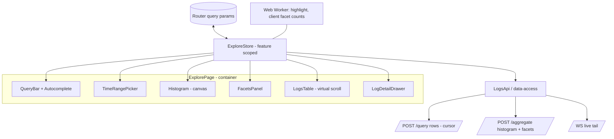

# Frontend System Design — Observability Edition

Format usually 45–60 min, whiteboard (Excalidraw/Miro). They evaluate: clarifying requirements, structure, trade-offs, depth where it matters (performance with big data), product sense, communication.

---

## 1. RADIO framework (use it every time)

| Step | Time | What to cover |
| --- | --- | --- |
| **R**equirements | 5–8 min | Functional (core flows, out of scope), non-functional (data volume, latency, real-time?, devices, a11y, i18n), users (SRE during incident vs dev exploring) |
| **A**rchitecture | 8–10 min | Component tree / modules, data flow, where state lives, server interaction |
| **D**ata model | 5–8 min | Client-side entities, state shape, URL schema, caching keys |
| **I**nterface (API) | 5–8 min | Endpoints/messages, request/response shapes, pagination, streaming, errors |
| **O**ptimizations | 15–20 min | Performance, UX, resilience, a11y, security, observability, testing, rollout |

Habits that score points:

- **Ask numbers**: "How many rows per query? Events per second in live tail? Spans per trace?" Then design for them.
- Draw boxes for components **and** for state stores, arrows for data flow.
- State a trade-off for every major decision.
- Tie optimizations to user impact ("during an incident, time-to-first-result matters more than completeness").
- Leave 5 min for "what would I do next / how would I roll it out".

---

## 2. Worked design: Logs Explorer (most likely question)

### Requirements

Functional:

- Query input (DataPrime/Lucene) with autocomplete of fields and values.
- Time range picker (relative/absolute), histogram of log volume over time (stacked by severity), brush to zoom.
- Results table: timestamp, severity, service, message; configurable columns from log fields.
- Facets sidebar: top values with counts for fields (service, severity, host…), click to include/exclude.
- Log detail drawer: full JSON, copy, "show surrounding logs", jump to trace by `traceId`.
- Shareable URL, saved views.
- Live tail mode.

Non-functional:

- Queries can match millions of logs; results arrive in seconds; UI must stay responsive (INP < 200 ms).
- Long sessions (hours), many tabs.
- Keyboard friendly, dark mode, accessible.

Out of scope (say it): alert creation, dashboards, query language backend.

### Architecture



- **URL is the source of truth** for query, range, filters, columns, selected log id. Store parses URL → derived request.
- Store derives one "query key" from (query, range, filters). On change: cancel in-flight requests, fire **aggregate** (fast) and **rows** (first page) in parallel.
- Presentational components are OnPush with inputs from store signals.

### Data model

```ts
type TimeRange = { kind: 'relative'; from: string /* now-15m */ } | { kind: 'absolute'; from: number; to: number };

interface ExploreQuery {
  text: string;
  range: TimeRange;
  filters: { field: string; op: 'is' | 'is_not'; values: string[] }[];
  columns: string[];
}

interface ExploreState {
  query: ExploreQuery;
  histogram: Status<{ bucketMs: number; buckets: { t: number; counts: Record<Severity, number> }[] }>;
  facets: Status<Record<string, { value: string; count: number }[]>>;
  rows: { status: 'idle' | 'loading' | 'loadingMore' | 'done' | 'error'; items: LogEntry[]; cursor?: string; total?: number };
  selectedId: string | null;
  live: { enabled: boolean; paused: boolean; buffered: number };
}
```

URL: `/explore?q=severity:error&from=now-1h&f=service:is:checkout,payments&cols=ts,sev,svc,msg&log=abc123`.

### API

- `POST /query` `{ query, range, filters, limit: 100, cursor? }` → `{ items, nextCursor, approxTotal }`. Cursor = (timestamp, id) for stable pagination as new logs arrive.
- `POST /aggregate` `{ query, range, filters, histogram: { buckets: ~100 }, facets: ['service','severity'] }` → buckets + top-N facet values.
- `GET /fields?prefix=` for autocomplete (cached).
- `WS /tail` subscribe with query; server pushes batches.
- Errors: query syntax error with position (to underline in editor), timeout with partial results, rate limited.

### Optimizations (go deep here)

- **Rendering:** virtual scroll with fixed rows; details in a drawer (avoid variable heights); column virtualization if > ~30 columns.
- **Fast first paint of results:** histogram + first 100 rows; prefetch next page near the end; cap at N rows in memory.
- **Cancellation & races:** `switchMap` per query key; abort signal to backend.
- **Histogram:** canvas, server-side bucketing with bucket size from range width (≈ chart px / 10); brush → absolute range.
- **Autocomplete:** debounce, cache by prefix, keyboard navigation, `aria-activedescendant` combobox pattern.
- **Highlighting** search terms: in a worker or on visible rows only; never `innerHTML` with log content (XSS — logs contain user input!). Split into text segments and render `<mark>` via template.
- **Big JSON in drawer:** collapsible tree, lazy expansion, virtualize if huge, copy path/value.
- **Live tail:** batching, ring buffer, pause on scroll, "N new" indicator.
- **Resilience:** keep previous results on error, retry button, partial results banner, timeouts.
- **Caching:** back/forward navigation restores results from an in-memory LRU keyed by query key.
- **A11y:** table semantics or grid role with keyboard navigation, focus management for drawer, color is not the only severity indicator.
- **Observability of the UI itself:** measure query→first-row time, error rates, INP on this page.
- **Testing:** unit tests for URL parse/serialize and store; component tests for facets; Playwright E2E for "search → open log → jump to trace".
- **Rollout:** feature flag, beta users, compare metrics vs old explore.

---

## 3. Worked design: Trace waterfall view (APM)

### Requirements

- Show a trace: spans as horizontal bars on a timeline, nested by parent/child, colored by service; error spans highlighted.
- Collapse/expand subtrees, search spans, click span → detail panel (attributes, events, logs for that span).
- Critical path highlight, minimap for long traces.
- Scale: typically 10–1,000 spans; worst case 50k+ spans.

### Key decisions

- **Data**: API returns flat spans `{ spanId, parentSpanId, service, name, startNs, durationNs, status, attrs }`. Build tree on the client in O(n) with a map (`10-live-coding-data-algorithms.md` task 2). For 50k spans do it in a worker.
- Handle **orphan spans** (parent missing due to sampling/late arrival) → attach to root with a marker; **clock skew** between services → child starting before parent; show warning, optionally adjust.
- **Flatten tree to visible rows** (respecting collapsed nodes) → virtual scroll list. Each row: indent by depth + bar positioned by `left = (start - traceStart)/traceDuration`, `width = duration/traceDuration`.
- **Rendering**: DOM rows with virtualization up to thousands; for extreme sizes render bars on canvas and keep the left column (names) as DOM for a11y/search.
- **Zoom** into a time window: recompute scale; minimap shows viewport.
- **Detail panel**: lazy-load span logs by `traceId + spanId` (correlation).
- **URL**: `/apm/trace/:traceId?span=:spanId` for sharing.

## 4. Worked design: Customizable dashboards

### Requirements

Grid of widgets (line chart, bar, table, single stat, logs list), drag/resize, per-widget query, global time range and variables (`$service`), auto-refresh, share/export, view vs edit mode. Up to ~50 widgets.

### Key decisions

- **Dashboard JSON schema** (versioned): `{ version, variables, timeRange, layout: [{ id, x, y, w, h }], widgets: { [id]: { type, query, viz options } } }`. Schema version + migrations for backward compatibility.
- **Widget plugin registry**: `type → lazy component` (`loadComponent`), common `WidgetHost` that handles loading/error/empty states and query execution. Each widget gets its own **component-scoped store** via `providers`.
- **Query orchestration**: global time range + variables → each widget's query; limit concurrency (e.g. 6 at once), prioritize visible widgets (`IntersectionObserver`), dedupe identical queries, cancel on change.
- **Auto-refresh**: pause when tab hidden; stagger refresh to avoid thundering herd.
- **Edit mode**: grid layout library (CDK drag-drop or gridster-like), undo/redo with a command stack, autosave draft vs explicit save, conflict detection (version/etag) when two users edit.
- **Perf**: `@defer (on viewport)`, canvas charts, shared crosshair via a throttled signal.
- **Error isolation**: one widget failing shows an inline error, not a broken page.

## 5. Outline only: RUM session explorer (use for a mock)

- Sessions list (filters: browser, country, app version, has errors, slow LCP), session detail timeline (views, actions, errors, network requests, vitals), session replay player synced with the timeline, error group with source-mapped stack trace, link to backend trace via `traceparent`.
- Hard parts to discuss: replay data size (stream chunks, seek via keyframes/full snapshots), syncing timeline cursor and replay at 60fps, PII masking, large session lists (server pagination + facets), linking frontend errors to deployed versions/source maps.

## 6. Other prompts to rehearse (10 min outline each)

- Alert rule builder (complex form, preview chart of what would have fired, validation).
- Service map (graph layout of 200 services, force-directed vs hierarchical, WebGL vs SVG, filtering by namespace).
- Query editor with autocomplete and syntax highlighting (CodeMirror/Monaco, language server for DataPrime, incremental parsing).
- Notification center / real-time incidents feed.

---

## Generic follow-ups they may throw

| Follow-up | Strong answer direction |
| --- | --- |
| "Now it's 10× more data" | Server-side aggregation, sampling, tighter caps, workers, canvas/WebGL, communicate limits in UI |
| "Backend is slow (10 s)" | Progressive/partial results, streaming, cancel, keep previous data, show progress, cache |
| "How do you test this?" | Pure logic unit tests, component tests, contract tests with backend, E2E for critical flows, visual regression for charts, perf tests in CI |
| "How would you roll it out?" | Feature flag, internal dogfooding, beta, metrics, rollback |
| "How do you know it's successful?" | Product metrics (time to find root cause, query success rate, feature adoption) + tech metrics (INP, error rate, query latency) |
| "Security?" | XSS from log content, RBAC on data, tenant isolation in URLs/caches, no secrets in URLs, CSP |
| "Accessibility?" | Keyboard nav, focus management, ARIA patterns (grid, combobox, tree), contrast in dark theme, non-color indicators |
